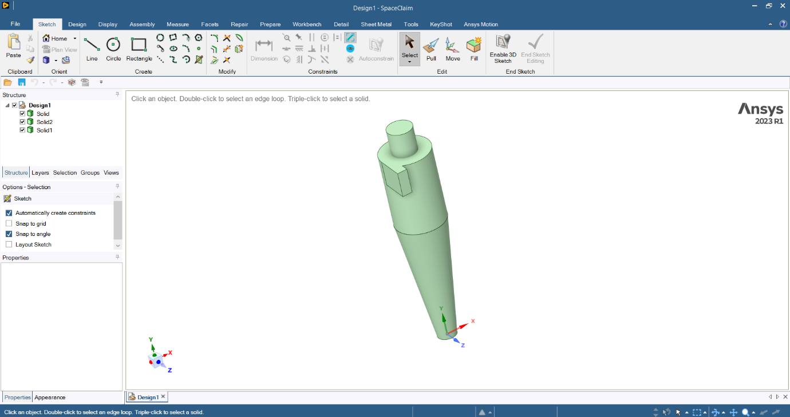
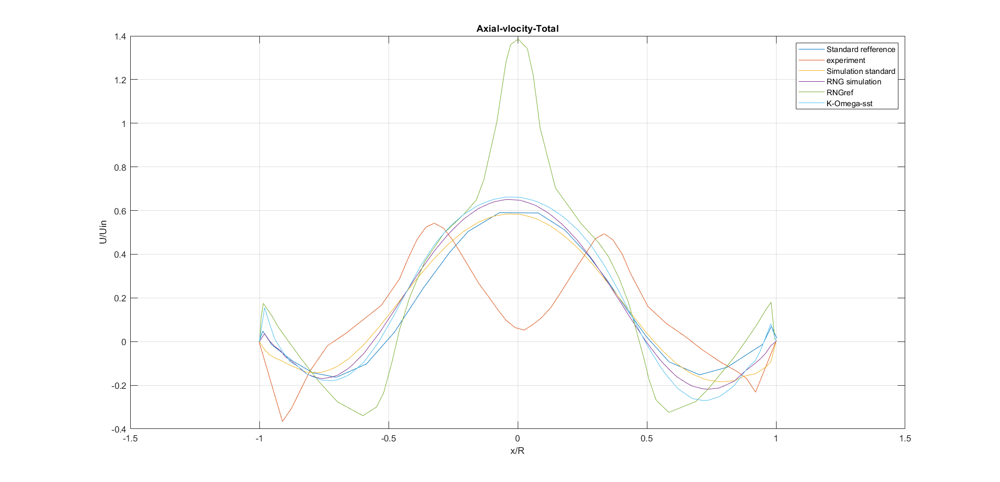
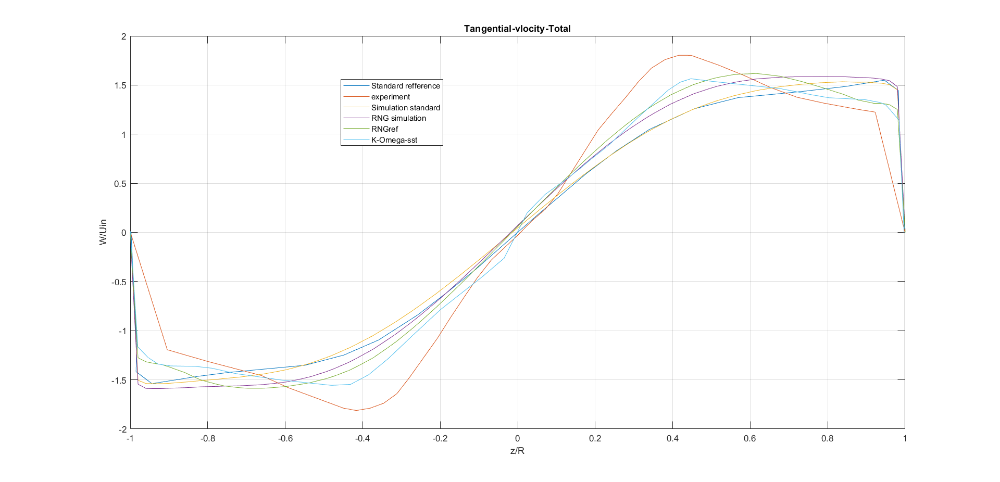

# Strömungssimulation eines Zyklonabscheiders (OpenFOAM)

Vergleich dreier RANS-Turbulenzmodelle an einer Stairmand-Zyklongeometrie anhand von Druckverlust und Geschwindigkeitsprofilen.

**Kontext:** Praxisprojekt bei DHCAE Tools GmbH, Krefeld, Sommersemester 2024, im Anschluss an das Ahmed-Body-Projekt (Maschinenbau M.Eng., Jade Hochschule)
**Software:** OpenFOAM, Ansys SpaceClaim, CastNET, ParaView, MATLAB

> **Vertraulichkeit:** Der zugrundeliegende Praxisbericht enthält vertrauliche, unternehmensinterne Inhalte. Dieses Repository zeigt daher ausschließlich Methodik, eingesetzte Standard-Software und Ergebnisse im Vergleich zu öffentlich verfügbaren Referenzdaten, keine internen Arbeitsabläufe oder firmenspezifischen Inhalte.

## Ziel

Zyklone erzeugen ein stark verdralltes, anisotropes Strömungsfeld und stellen hohe Anforderungen an das Turbulenzmodell. Verglichen wurden drei gängige RANS-Modelle hinsichtlich Druckverlust und Geschwindigkeitsprofil an einer literaturbekannten Geometrie.

## Geometrie und Netz

Standardproportionen eines Stairmand-Hochleistungszyklons nach Hoekstra (2000): Austrittsrohrdurchmesser De = 0,5 D, Zylinderhöhe 1,5 D, Konushöhe 2,5 D. Geometrie in SpaceClaim, Vernetzung in CastNET mit Hex-Core-Volumennetz, Extrusionsvernetzung an Ein- und Auslässen und aufgelöster Grenzschicht.

## Methodik

OpenFOAM, einphasig, Eintrittsgeschwindigkeit 20 m/s, gleiche Löser- und Diskretisierungseinstellungen wie im Ahmed-Body-Projekt. Modelle: k-ε (RNG), k-ε (Standard), k-ω (SST).

## Ergebnisse

Druckverlust bei 20 m/s:

| Turbulenzmodell | Δp (Pa) |
|---|---|
| k-ε (RNG) | 1385,8 |
| k-ε (Standard) | 1297,52 |
| k-ω (SST) | 1479,72 |

Zusätzlich wurden axiale und tangentiale Geschwindigkeitsprofile berechnet (Umrechnung von kartesischen in Zylinderkoordinaten) und mit den Experimentdaten und den Referenzläufen des Validierungsfalls verglichen.

- Im axialen Profil liegen die drei eigenen Simulationen nahe beieinander (Maximum auf der Achse etwa 0,58 bis 0,66 U/U_in, Standard-k-ε am niedrigsten). Im Diagramm sind zusätzlich Experimentdaten sowie Standard-k-ε und RNG-k-ε des Validierungsfalls als „Standard reference“ und „RNGref“ eingezeichnet. Die RNG-Referenz zeigt ein deutlich höheres Maximum von etwa 1,4 U/U_in.
- Keines der Modelle bildet den ausgeprägten Geschwindigkeitseinbruch nahe der Achse (x/R ≈ 0) im axialen Profil ab. Alle sagen ein einzelnes Maximum voraus. Das entspricht der bekannten Grenze isotroper Wirbelviskositätsmodelle bei stark verdrallter Strömung.

## Erkenntnisse

- Die Modellwahl beeinflusst den berechneten Druckverlust spürbar.
- Für zylindrische Größen aus einer kartesischen Lösung ist eine sorgfältige Koordinatentransformation nötig.
- Sinnvolle Erweiterung: dispergierte Zweiphasenmodellierung (z. B. DPM) zur Berechnung des Abscheidegrads. Sie wurde nicht durchgeführt.

Portfolio mit Abbildungen: <https://pouria-kamali.de/projekt-zyklon.php>

## Abbildungen

### Geometrie

Zyklon in Ansys SpaceClaim, Proportionen nach Hoekstra (2000).

### Geschwindigkeitsprofile

Axiales und tangentiales Geschwindigkeitsprofil (normiert mit der Eintrittsgeschwindigkeit) über dem normierten Radius, eigene Simulation (Standard-k-ε, RNG-k-ε, k-ω SST) im Vergleich zu Experiment und Referenzläufen des Validierungsfalls. Die Diagramme stammen aus MATLAB, die Legenden entsprechen dem ursprünglichen Plot.

## Repository-Inhalt

Dieses Repository dokumentiert Methodik und Ergebnisse. Case-Dateien, Rechendaten, der Praxisbericht sowie unternehmensinterne Arbeitsabläufe und Software-Einstellungen sind nicht enthalten.
